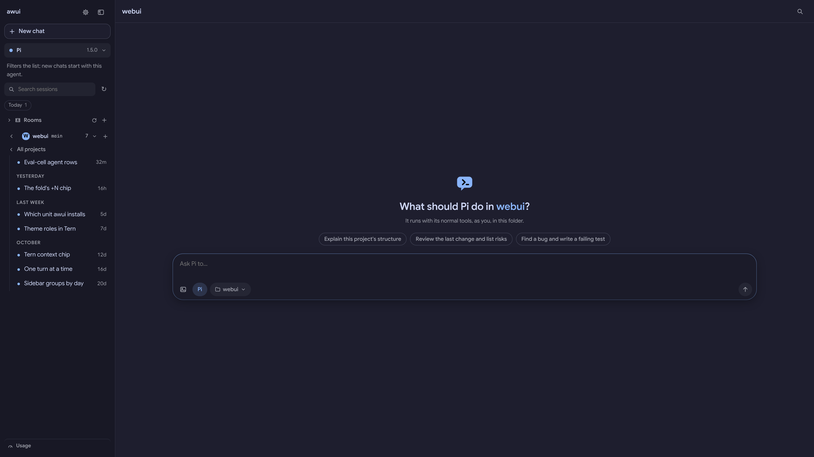

# awui

awui is a local, private web UI for the coding agents you already use: **Pi**, **omp**, **Hermes**, **Claude Code**, **Codex**, **OpenCode**, **Grok Build**, and **DeepSeek Harness**.

Each agent keeps its own models, logins, settings, tools, and session files. awui gives it one window — on your desktop, on your phone over Tailscale, or in a terminal with `atui` and `awui tern` — and adds what a terminal does not have: tabs, checkpoints, search across chats, review comments, usage, and notifications.



## Install

### From a release (beta)

Download one file for your platform from the [releases page](https://github.com/drishal/awui/releases), make it executable, and run it. No Node or Bun is needed.

| Platform | File |
|---|---|
| Linux x64 | `awui-linux-x64` (also carries the desktop app) |
| Linux arm64 | `awui-linux-arm64` |
| macOS arm64 / x64 | `awui-darwin-arm64` / `awui-darwin-x64` |
| Windows x64 | `awui-windows-x64.exe` |

```bash
chmod +x awui-linux-x64
./awui-linux-x64
```

Open http://127.0.0.1:4783. macOS and Windows builds are unsigned, so the system will ask you to allow them; checksums are on the release page.

### From source

You need Node 22.19+, npm, and Bun 1.3.14+ for the build (Bun 1.3.5+ supplies the compiled terminal's native PTY; the minimum client version remains Bun 1.3.14). On NixOS use `devenv shell`. This builds the same self-contained binary the releases ship, and links it into `~/.local/bin` when that folder exists.

```bash
git clone https://github.com/drishal/awui.git
cd awui
npm ci
npm run build:binary     # → dist/bin/<platform>-<arch>/awui
awui
```

The agent CLIs you use are installed and logged in separately; a missing one shows as unavailable instead of breaking the app.

### The desktop app (optional)

The Linux build carries an Electron app: a window, a tray, and `awui://` links over the same server, with no second copy of the UI. It extracts itself into awui's state folder the first time it runs.

From a release:

```bash
./awui-linux-x64 desktop                  # attach to a running server, or start one
./awui-linux-x64 install desktop          # link it as ~/.local/bin/awui-desktop
./awui-linux-x64 desktop --install-icon   # add it to the application menu
```

From a checkout:

```bash
npm --prefix apps/desktop ci      # once: Electron and its packager
npm run desktop                   # run the app (attaches to the server on :4783)
npm run build:desktop             # a binary that carries the app
npm run build:desktop --electron  # force rebuilding the desktop shell itself
```

macOS and Windows desktop packages exist (`npm --prefix apps/desktop run dist:mac` or `dist:win`), but only the Linux AppImage is a single file awui's binary can carry today.

## First chat

1. Pick an agent and a project folder.
2. Type, or paste a screenshot.
3. Steer it, queue a follow-up, or stop it while it works.
4. Close the browser if you like — the run keeps going on the server.

## Docs

| | |
|---|---|
| [Install, desktop, service, Windows](docs/install.md) | the long install guide and autostart |
| [Configuration](docs/configuration.md) | `config.yml`, environment, herdr |
| [Using awui](docs/usage.md) | the interface, turn by turn |
| [In a terminal](docs/terminal.md) | `atui` and `awui tern` |
| [Harnesses](docs/harnesses.md) | adding or fixing a harness |
| [Architecture](docs/architecture.md) | how each agent is driven, adapters, approvals |
| [Security](docs/security.md) | LAN, Tailscale, the threat model |
| [Theme](docs/theme.md) | colours, base16, stylix |
| [Testing](docs/testing.md) | unit, e2e, smoke |
| [Credits](docs/credits.md) | design credits, what is not included |
| [UI map](docs/ui.md) | which component draws what |
| [Screenshots](docs/screenshots) | every screen |

## License

MIT.
