# Screenshots

All of them come from a throwaway `awui` server (port 4799, its own config and state folders)
driving the real **Pi** harness over two repositories on this machine: `webui` itself and
`dotfiles`. Nothing of the author's own server, chats, or state folder is touched: the state is a
scratch folder, and the agent dir is one whose `sessions/` holds only the sessions shown (its
other entries are symlinks to the real `~/.pi/agent`, so Pi starts with the same settings).

The transcripts are composed for the pictures, in Pi's own v3 session shape, from the work this
repository did — the agent rows an eval cell spawns, a board's one-turn-at-a-time scheduler, the
Tern context chip, the unit-name check, the NixOS module. Prompts and replies are written to read
clearly; the file paths, commands, and result shapes are the ones the code uses. awui reads the
files like any other session (history, todos, usage are real reads of the file), and the harness
resumes them, so the model chip, the thinking level, and the context ring are the live ones.

Desktop shots are a 1920×1080 window at 2× (3840×2160 files); the phone ones are 390×844 at 2×.
That is the author's own theme (`Catppuccin Mocha` as a base16 theme file); `light.png` is the
same app with no theme file and a light system appearance.

| | |
|---|---|
| 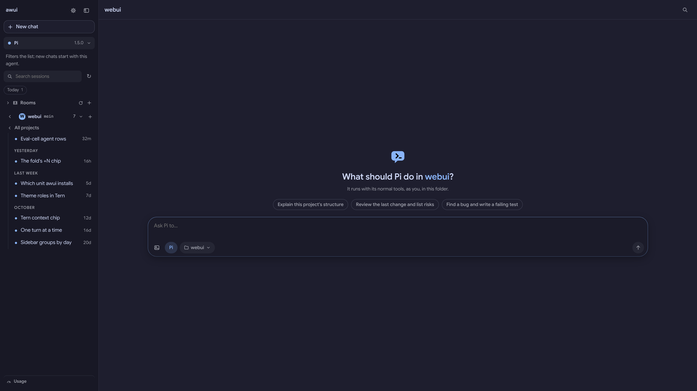 **Start screen.** A folder chosen, the project's sessions beside it, three ways to begin, and the composer with the harness and the folder. | 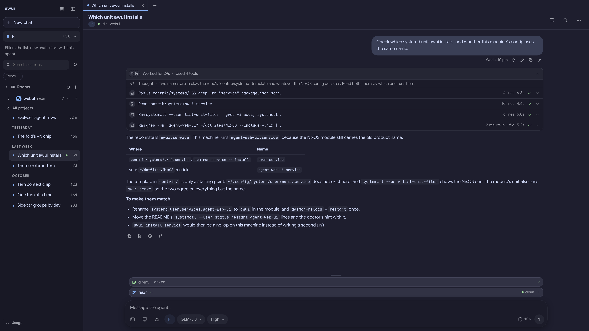 **A turn.** The prompt, the work it took folded open — the thought, the commands, and the answer with the two unit names side by side. |
| 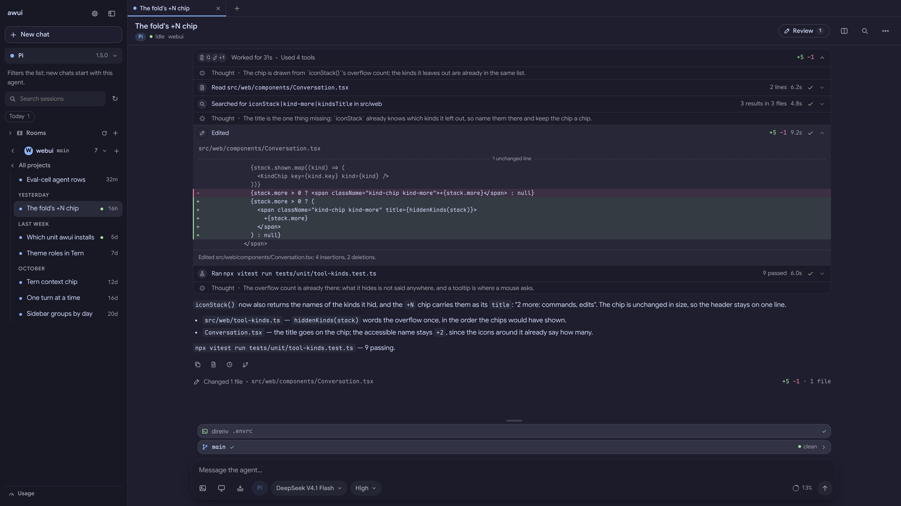 **A turn's calls.** One row per call — a read, a search, an edit opened to its diff, the test run — each a single line until you open it. | 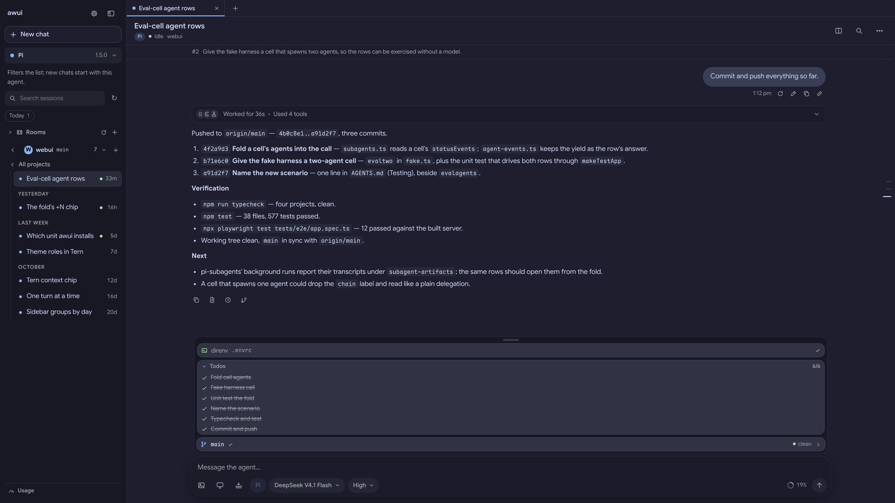 **The end of a longer session.** The commits it pushed, the checks, and what is next, beside the todo list it kept, the project's git row, and the context ring. |
| 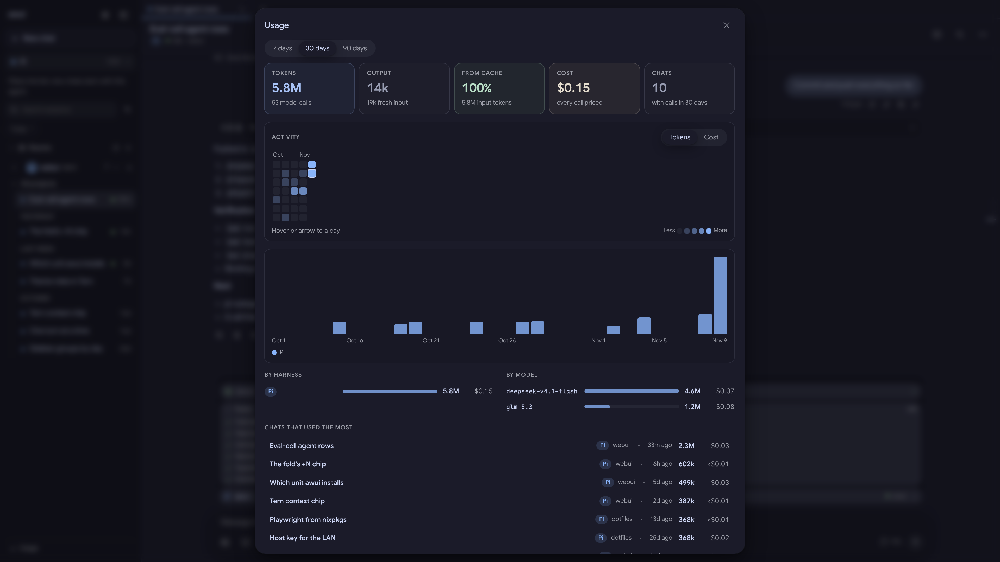 **Usage.** Tokens, cache share, cost, the month's activity, and which harness, model, and chat spent them — read from the session files. | 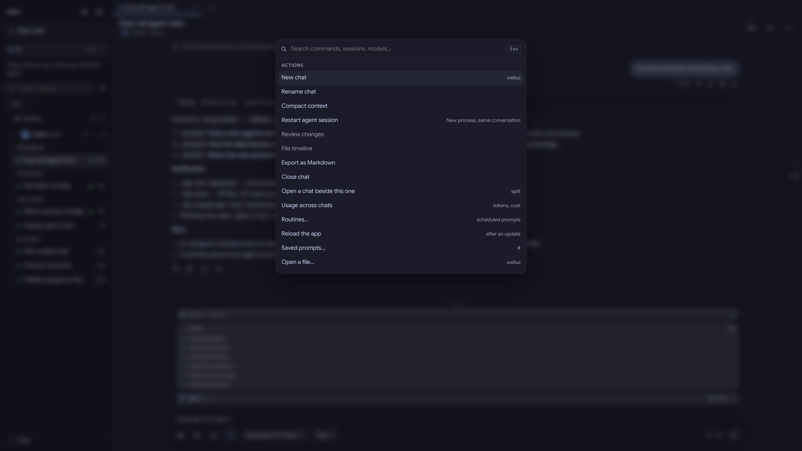 **The palette** (Ctrl/⌘-K): actions, settings, sessions, and rooms. |
| 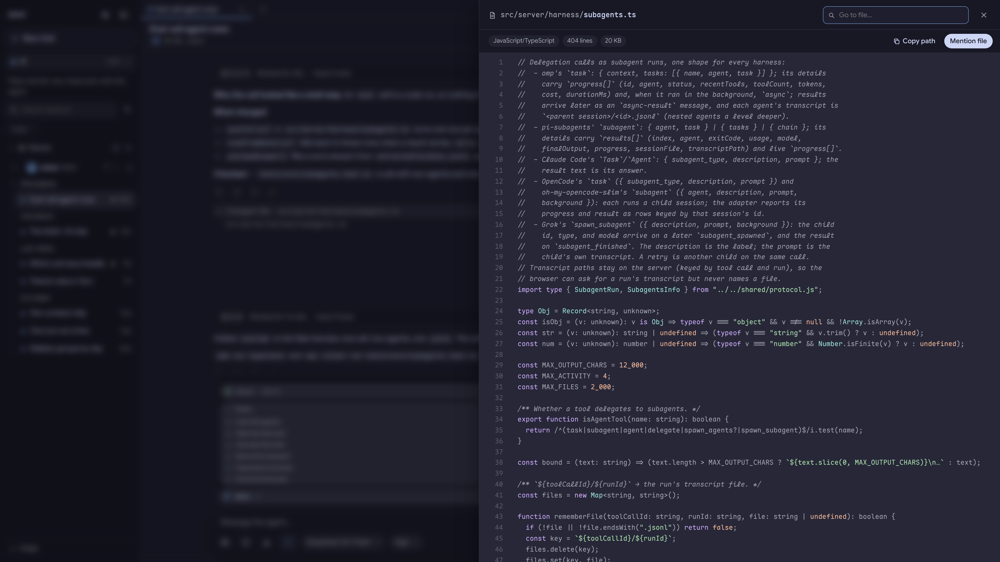 **The file viewer:** a project file, coloured, with *Mention file* into the composer. | 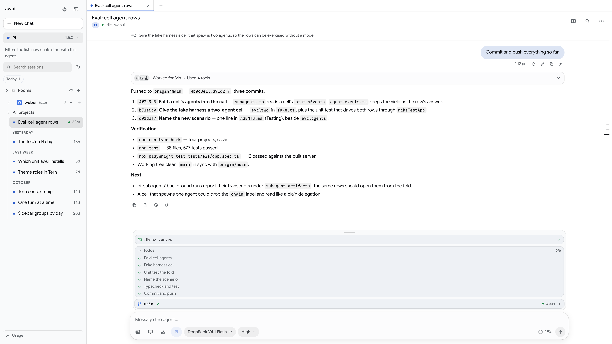 **The light palette.** The same chat, `prefers-color-scheme: light`, no theme file. |
| 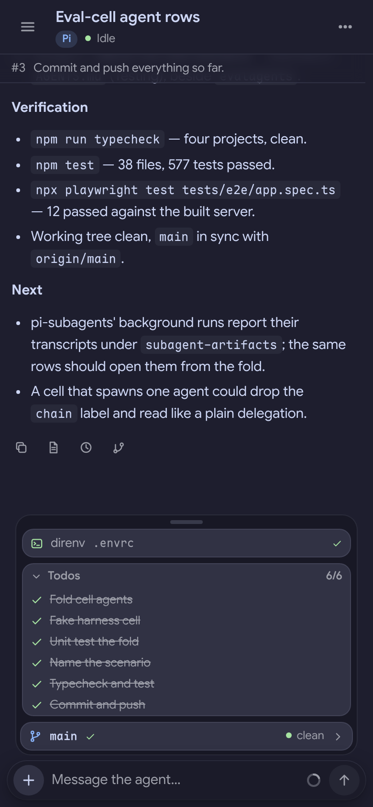 **A phone, at the end of the same chat:** the todo list, the git row, and the composer. | 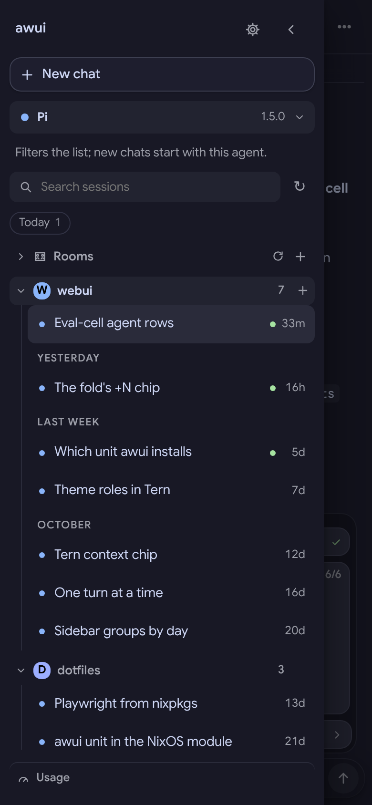 **A phone, the drawer:** both projects with their monograms and their sessions. |
| 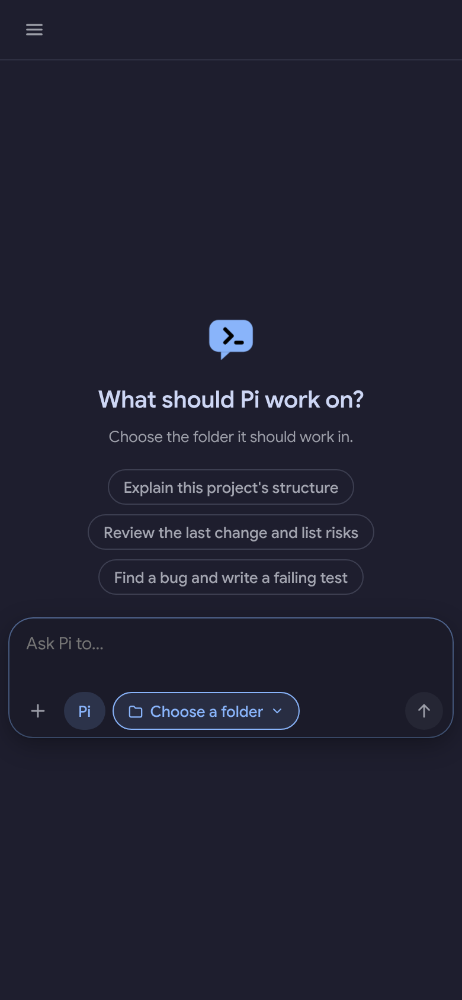 **A phone, the start screen.** | |

Regenerating them: build the app, run a server on another port with its own `AWUI_CONFIG_DIR`,
`AWUI_STATE_DIR`, and a scratch `PI_CODING_AGENT_DIR` (only the sessions you want in its
`sessions/`), point `WORKSPACE_ROOTS` at the project folders, and drive it with Playwright at
`deviceScaleFactor: 2` — `1920×1080`, and `390×844` for the phone shots — setting the state
through the REST API (`POST /api/workspaces/open`, `POST /api/chats/resume`) and the rest by
role and name. Playwright's browsers come from nixpkgs through `PLAYWRIGHT_BROWSERS_PATH` (never
`npx playwright install`). Then `oxipng -o3 --strip safe docs/screenshots/*.png`.

One thing is not exactly as the app draws it: the Usage panel's inner scroller was allowed its
full height for the picture (`max-height` is what makes it scroll on screen). Everything else is
the built app, unmodified.
